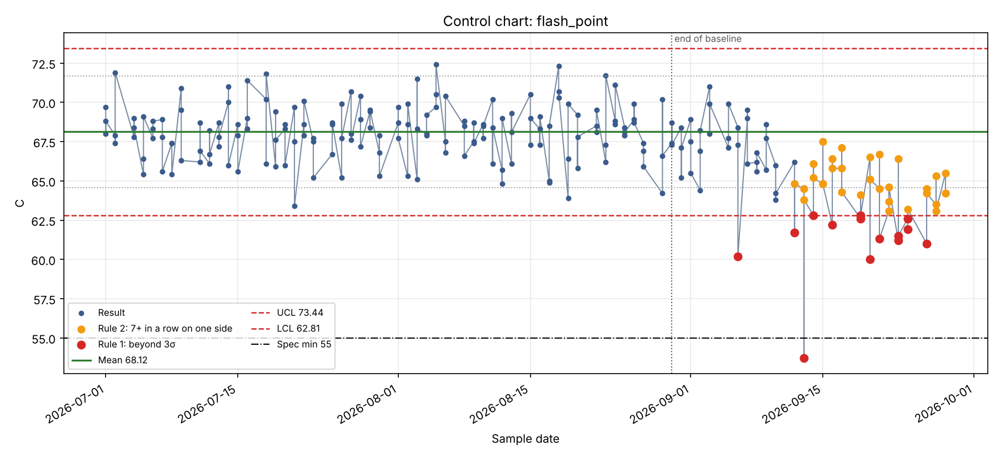
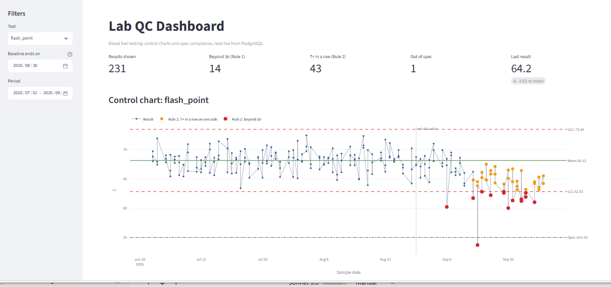

# Laboratory QC Monitoring: Control Charts for Fuel Testing

A small end-to-end data project for a petroleum/chemistry testing laboratory:
**PostgreSQL database → SQL analysis → Python control charts → interactive Streamlit dashboard.**

> The data is **synthetic** (generated by `generate_lab_data.py`) and modelled on diesel fuel testing
> (density, viscosity, flash point, water, sulfur) with limits in the style of EN 590.
> It contains deliberately planted problems so the methods can be demonstrated.




## The problem

Labs usually check every result against the specification: pass or fail.
That misses a slow instrument drift, because results keep passing while the process is already moving
away from its normal behaviour. **Statistical control charts** catch this earlier.

## Key finding

In the data, the flash point instrument starts to drift downwards on **2026-08-30**.

| | Date | What it shows |
|---|---|---|
| First control-chart alarm | **2026-09-06** (DSL-0174, 60.2 °C, below the lower control limit 62.81) | about a week after the drift began |
| First result below the specification (min 55 °C) | **2026-09-13** (DSL-0191, 53.7 °C) | one result out of 231 |

Most of the alarm points (60-62 °C) were still **inside the specification**, so a pass/fail check alone
would not have flagged anything until much later.

## How it works

1. **Database** (`schema.sql`, `load_data.sql`): three tables, `tests` (spec limits), `samples`, `results`,
   plus views that label each result `OK`, `OUT_OF_SPEC` or `MISSING` and summarise each test.
2. **Control limits**: mean and standard deviation are calculated from a known-good *baseline period*
   (before the drift), then UCL/LCL = mean ± 3σ. Using all data would let the drift inflate σ and hide itself.
3. **Alarm rules**
   - Rule 1: a single point beyond ±3σ.
   - Rule 2: 7 or more consecutive points on the same side of the mean (detects slow shifts).
4. **Dashboard** (`app.py`): choose the test, the baseline end date and the period; see KPI cards,
   an interactive chart (hover shows the sample ID) and a downloadable alarms table.

## Data model

```
tests(test_code PK, unit, min_limit, max_limit, method)
samples(sample_id PK, sample_date, product, batch, analyst)
results(result_id PK, sample_id FK, test_code FK, value)   -- one row per sample per test
views: v_results_checked, v_out_of_spec, v_test_summary
```

## Run it yourself

Requirements: PostgreSQL 14+, Python 3.10+.

```bash
pip install -r requirements.txt
```

**1. Create the database** (Linux/macOS: `./setup.sh`). On Windows with pgAdmin:
create a database named `lab_qc`, run `schema.sql`, then load `lab_qc_data.csv` into a staging table
and run the INSERT statements from `load_data.sql`.

**2. Tell the scripts how to connect** (nothing is stored in the code):

```powershell
# Windows PowerShell
$env:LAB_DB_PASSWORD = "your_postgres_password"
```
```bash
# Linux / macOS
export LAB_DB_PASSWORD="your_postgres_password"
```
Optional: `LAB_DB_USER`, `LAB_DB_HOST`, `LAB_DB_PORT`, `LAB_DB_NAME`.

**3. Generate a chart**

```bash
python control_chart.py flash_point      # saves charts/flash_point_control_chart.png
```

**4. Open the dashboard**

```bash
python -m streamlit run app.py
```

## Files

| File | Purpose |
|---|---|
| `generate_lab_data.py` | Creates the synthetic dataset and spec limits |
| `schema.sql`, `load_data.sql`, `setup.sh` | Database schema, data loading, one-step setup |
| `control_chart.py` | Control limits, alarm rules and static chart |
| `app.py` | Streamlit dashboard |
| `lab_qc_data.csv`, `specs.csv` | Generated data |

## Limitations and next steps

- The baseline period is chosen by hand. An outlier inside it (e.g. the viscosity value of 6.97 on 2026-07-23)
  widens the limits; excluding outliers before calculating them would be more robust.
- Rule 2 can raise occasional false alarms on a long series; other Western Electric rules could be added.
- Measurement uncertainty (ISO 17025) and instrument calibration tracking are natural extensions.

**Tools:** PostgreSQL · SQL · Python (pandas, matplotlib, SQLAlchemy) · Plotly · Streamlit

---

## ملخص بالعربي

مشروع تحليل بيانات لمعمل فحص وقود: قاعدة بيانات PostgreSQL، وتحليل بـ SQL، ومخططات تحكم (Control Charts) بـ Python،
ولوحة تفاعلية بـ Streamlit. البيانات وهمية ومولّدة بالكود، وفيها انحراف مقصود في جهاز قياس نقطة الوميض.

الفكرة: فحص النتيجة مقابل المواصفة وحده يكشف المشكلة متأخراً، بينما مخطط التحكم كشف الانحراف في **2026-09-06**
أي بعد نحو أسبوع من بدايته، في حين أول نتيجة خرجت عن المواصفة كانت في **2026-09-13**، ومعظم نقاط الإنذار كانت لا تزال داخل المواصفة.
